  

  
  

## Sobre mim

Sou desenvolvedor pleno e trabalho no dia a dia com **C#/.NET e SQL Server**: manutenção e evolução de sistemas corporativos, procedures, importação e automação de dados e integração entre sistemas por **APIs REST**.

Passei por suporte e infraestrutura de TI antes de entrar de vez em desenvolvimento, e levo essa visão de quem usa e de quem mantém o sistema para dentro do código. Agora estou abrindo o leque para o front-end com **React**, rumo a uma atuação Full Stack.

  

## Minha trilha

  

## Projetos em destaque

Os dois repositórios são privados, então aqui vai a vitrine.

<table>
  <tr>
    <td width="50%"></td>
    <td width="50%"></td>
  </tr>
</table>

Solo TCG é um projeto de fã, sem fins comerciais.

## O que eu faço

- Crio e otimizo **stored procedures** e rotinas de importação de dados no SQL Server.
- Mantenho e evoluo **CRMs internos**: análise de falhas, depuração e novas funcionalidades.
- Integro sistemas corporativos por **APIs REST**, para os dados circularem sem retrabalho.
- Automatizo processos internos que antes eram manuais.

## Tecnologias

  

## Em foco agora

- Bacharelado em **Sistemas de Informação** (FMU), com formatura prevista para 2027.
- **React**, para fechar o ciclo Full Stack.
- **Node.js** e **IA aplicada** ao desenvolvimento.

## Formação e cursos

- Técnico em Informática: CTI "Isaac Portal Roldán" (2018)
- VueJS 2 (Udemy, 2024) · Mastering JavaScript (Udemy, 2024)
- PHP Orientado a Objetos (Udemy, 2023)
- Desenvolvedor Front-end (Rocketseat, 2022)
- Modelagem e Lógica de Banco de Dados (Fundação Bradesco)

Idiomas: português (nativo) e inglês (intermediário).

## Contato

Me encontre no [LinkedIn](https://www.linkedin.com/in/leonardovono/) ou escreva para [vonodev@gmail.com](mailto:vonodev@gmail.com).

🇺🇸 English

 

Mid-level Software Developer based in Bauru, Brazil, working with **C#/.NET, SQL Server and REST APIs**: stored procedures, data imports, process automation, internal CRM maintenance and system integration. Currently growing into a Full Stack role with **React**, and pursuing a B.S. in Information Systems (expected 2027).

Featured (private) projects: **Beat Me!**, a workout app with friend competition (React PWA, Cloudflare Workers, Supabase), and **Solo TCG**, a fan-made card game (JavaScript, Canvas, Capacitor).

Languages: Portuguese (native), English (intermediate). Reach me on [LinkedIn](https://www.linkedin.com/in/leonardovono/).

  

